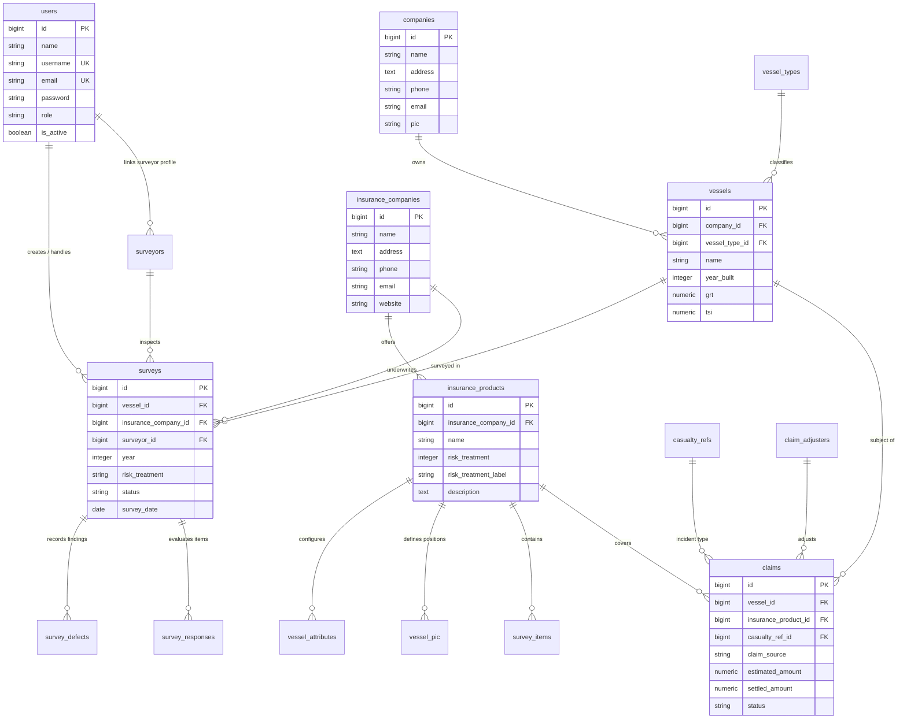

# LAPORAN DOKUMENTASI TEKNIS & FUNGSIONAL PROYEK
# MODERNISASI SISTEM VESSEL RISK MANAGEMENT (VRM)
### MARINE INSURANCE BROKER (MIB)

---

> [!NOTE]
> **Status Dokumen**: *Final Production Ready*  
> **Tanggal Rilis**: 11 November 2026  
> **Versi Sistem**: 2.0 (Modern Architecture)  
> **Target Lingkungan**: Production & Staging Server (`http://dev-vrm.dudukdulu.com/`)  
> **Repository**: `github.com/orochimadit/vrm-mib` (Branch: `main`)  

---

## DAFTAR ISI

1. [Bab 1: Executive Summary & Latar Belakang Proyek](#bab-1-executive-summary--latar-belakang-proyek)
2. [Bab 2: Arsitektur Sistem & Spesifikasi Teknologi](#bab-2-arsitektur-sistem--spesifikasi-teknologi)
3. [Bab 3: Komparasi Arsitektur Database (Legacy vs Modern) & Diagram ERD](#bab-3-komparasi-arsitektur-database-legacy-vs-modern--diagram-erd)
4. [Bab 4: Modul Fungsional & Alur Kerja Bisnis (1:1 Flow)](#bab-4-modul-fungsional--alur-kerja-bisnis-11-flow)
5. [Bab 5: Manajemen Pengguna & Hak Akses Multi-Role (RBAC)](#bab-5-manajemen-pengguna--hak-akses-multi-role-rbac)
6. [Bab 6: Katalog Visual & Galeri Dokumentasi Screenshot](#bab-6-katalog-visual--galeri-dokumentasi-screenshot)
7. [Bab 7: Panduan Deployment, Operasional & Pemeliharaan](#bab-7-panduan-deployment-operasional--pemeliharaan)

---

## BAB 1: EXECUTIVE SUMMARY & LATAR BELAKANG PROYEK

### 1.1 Latar Belakang
Sistem **Vessel Risk Management (VRM)** merupakan platform inti (*mission-critical application*) yang dioperasikan oleh **Marine Insurance Broker (MIB)** untuk mengelola penilaian risiko armada kapal (*vessel risk assessment*), manajemen penugasan survei kelautan (*marine survey inspection*), manajemen mitigasi polis asuransi perkapalan, serta penanganan kasus klaim (*claim solutions*).

Sistem terdahulu (*legacy*) dibangun di atas framework **CodeIgniter 3 HMVC** dengan basis data **MySQL 5.7**. Seiring bertambahnya volume data dan kebutuhan pelaporan eksekutif yang dinamis, sistem lama menghadapi beberapa keterbatasan:
1. Arsitektur monolitis lama tanpa standarisasi *Foreign Key Constraint* formal di level database.
2. Mekanisme otentikasi lama yang rentan dan belum mendukung fleksibilitas *dual-login* (Username/Email).
3. Ketiadaan dashboard analitik interaktif terintegrasi untuk jajaran direksi dan underwriter.
4. Kesulitan skalabilitas pemeliharaan kode sumber jangka panjang.

### 1.2 Sasaran Proyek Modernisasi
Proyek ini bertujuan melakukan migrasi menyeluruh ke ekosistem **Laravel 11 & PostgreSQL 14** dengan prinsip:
* **Zero Disruption & 1:1 Visual Parity**: Seluruh tampilan antarmuka (UI *Jeramin Theme*), tombol aksi, modal interaktif, dan format laporan dibuat persis 1:1 seperti sistem yang telah terbiasa digunakan pengguna.
* **Zero Data Loss**: Memindahkan 100% data historis penugasan survei, armada kapal, profil asuransi, hingga ribuan item survei secara presisi tanpa ada relasi yang terputus.
* **Modern Executive Dashboard**: Memadukan chart horizontal *Total Policy by Years* persis sistem lama dengan 6 kartu KPI eksekutif dan 4 diagram visualisasi resiko modern.
* **Dual-Engine Architecture**: Menyediakan antarmuka operasional 1:1 (*Jeramin Theme*) untuk operasional harian, serta panel administrasi terpadu (*Filament v3*) untuk tata kelola data master.

### 1.3 Ringkasan Metrik Data yang Dimigrasikan
| Indikator Kunci | Jumlah Riil di Database | Keterangan |
| :--- | :--- | :--- |
| **Total Polis & Penugasan Survei** | **987** Penugasan | Tersebar dari tahun 2023 s.d. 2027 |
| **Total Armada Kapal Terdaftar** | **699** Kapal | Dilengkapi data GRT, Tahun Pembuatan, & Tipe Kapal |
| **Total Tonase Kotor Armada (GRT)** | **1.203.539** GRT | Akumulasi kapasitas tonase armada yang diawasi |
| **Total Nilai Pertanggungan (TSI)** | **\$91.95 Miliar USD** | Nilai pertanggungan kapal yang diproteksi |
| **Item Checklist Survei Kelautan** | **1.433** Item | Checklist terstandarisasi per kategori inspeksi |
| **Atribut Teknis & Spesifikasi Kapal** | **1.296** Atribut | Meliputi General, Main Engine, Aux Engine, & Spaces |
| **Kasus Solusi Klaim (*Claims*)** | **22** Kasus | Terbagi atas status Ongoing, Accepted, dan Rejected |
| **Akun Pengguna Terdaftar** | **253** Akun | Terdistribusi ke dalam 5 hak akses peran |

---

## BAB 2: ARSITEKTUR SISTEM & SPESIFIKASI TEKNOLOGI

### 2.1 Spesifikasi Stack Teknologi

```
+------------------------------------------------------------------------+
|                         VESSEL RISK MANAGEMENT                         |
|                         DUAL-ENGINE ARCHITECTURE                       |
+------------------------------------------------------------------------+
|  [Operational Frontend: Jeramin 1:1]   |  [Admin Core: Filament v3]    |
|  - Bootstrap 4 & Custom Jeramin Theme  |  - Tailwind CSS & Alpine.js   |
|  - Highcharts.js & DataTables          |  - Livewire 3 Components      |
|  - Blade Templating (1:1 Legacy Look)  |  - Advanced Resource Manager  |
+------------------------------------------------------------------------+
|                       APPLICATION LAYER (Laravel 11)                   |
|  - PHP 8.4 Engine (Strict Types, High Concurrency)                     |
|  - Role-Based Access Control (RBAC) via Authenticatable User Model     |
|  - Form Request Validation & CSRF Protection                           |
|  - Dedicated Legacy Controllers & Document Streaming                   |
+------------------------------------------------------------------------+
|                          PERSISTENCE LAYER                             |
|  - PostgreSQL 14 (ACID Compliant, Strong Typing, Foreign Keys)         |
|  - Version-Controlled Database Migrations & Seeds                      |
+------------------------------------------------------------------------+
|                      DEPLOYMENT & INFRASTRUCTURE                       |
|  - Ubuntu 22.04 LTS VPS (Host: 149.129.235.91:3031)                    |
|  - Nginx Reverse Proxy with HTTP/2 & SSL Termination                   |
|  - Git Version Control (github.com/orochimadit/vrm-mib)                |
+------------------------------------------------------------------------+
```

### 2.2 Rincian Lingkungan Server
* **Server IP**: `149.129.235.91` (Port SSH: `3031`)
* **Domain Staging/Production**: `http://dev-vrm.dudukdulu.com/`
* **Root Direktori Proyek**: `/var/www/vrm-modern`
* **Web Server & Gateway**: Nginx 1.18 + PHP 8.4-FPM
* **Database Driver**: `pgsql` (Database: `vrm_modern`, Port: `5432`)

---

## BAB 3: KOMPARASI ARSITEKTUR DATABASE (LEGACY VS MODERN) & DIAGRAM ERD

### 3.1 Tabel Perbandingan Arsitektur Database

| Aspek Penilaian | Sistem Lama (*Legacy MySQL*) | Sistem Baru (*Modern PostgreSQL*) | Manfaat & Nilai Tambah |
| :--- | :--- | :--- | :--- |
| **Database Engine** | MySQL (Kombinasi MyISAM / InnoDB) | **PostgreSQL 14** | Penuh kepatuhan ACID, performa agregasi analitik jauh lebih cepat dan andal. |
| **Manajemen Relasi** | Sebagian besar *virtual relation* (di level kode PHP tanpa FK). | **Strict Foreign Key Constraints** (`ON DELETE CASCADE` / `SET NULL`). | Mencegah terjadinya *orphan data* (data yatim piatu) saat entitas induk dihapus. |
| **Manajemen Otentikasi** | Tabel `admin` & `admin_level` terpisah. | Tabel tunggal **`users` (RBAC terpadu)**. | Manajemen hak akses sentral, multi-role terstruktur, dan dukungan login fleksibel. |
| **Keamanan Password** | MD5 / Plain Hash historis. | **Bcrypt Hashing (Cost 12)**. | Memenuhi standar keamanan perbankan dan asuransi (*cybersecurity compliant*). |
| **Skema Versioning** | File dump SQL manual tanpa pelacak riwayat. | **Laravel Database Migrations**. | Seluruh perubahan struktur tabel tercatat di Git dan dapat direproduksi instan. |
| **Pencatatan Audit** | Kolom waktu tidak konsisten pada beberapa tabel. | **`created_at` & `updated_at` di seluruh tabel**. | Memudahkan audit forensik dan penelusuran waktu perubahan data secara akurat. |
| **Manajemen Atribut Kapal** | Format tabel lokal tanpa standardisasi kunci. | Tabel ternormalisasi `vessel_attributes` & `vessel_pic`. | Konfigurasi spesifikasi kapal menjadi modular dan dinamis per produk asuransi. |
| **Pelacakan Defect & Bukti** | File foto penugasan tersimpan tanpa relasi tegas. | Relasi eksplisit `survey_defects`, `survey_responses_attachment`. | Bukti perbaikan (*rectification*) kapal terhubung langsung ke temuan defect. |

---

### 3.2 Diagram Relasi Entitas (ERD Sistem Modern)



---

## BAB 4: MODUL FUNGSIONAL & ALUR KERJA BISNIS (1:1 FLOW)

### 4.1 Modul 1: Executive Analytics Dashboard
* **Alamat Akses**: `/admin/dashboard` & `/dashboard`
* **Visualisasi Utama 1:1 (*Total Policy by Years*)**:
  * Menggunakan engine grafik **Highcharts** dengan tema kanvas gelap (`#181818`), aksen bar biru elektrik (`#00b4d8`), serta label nilai presisi sesuai database riil:
    * Tahun 2026: **418** penugasan
    * Tahun 2025: **203** penugasan
    * Tahun 2024: **191** penugasan
    * Tahun 2023: **146** penugasan
    * Tahun 2027: **23** penugasan
    * Kategori 0/Lainnya: **6** penugasan
  * **Interaktivitas Penuh**: Mengklik salah satu bar tahun langsung mengarahkan pengguna ke daftar survei tahun tersebut.
  * Dilengkapi tombol navigasi cepat: `ALL`, `2027`, `2026`, `2025`, `2024`, `2023`.
* **6 Kartu Ringkasan KPI Eksekutif**:
  1. *Total Policies*: 987 Polis & Penugasan
  2. *Total Vessels*: 699 Armada Kapal Terdaftar
  3. *Total Gross Tonnage*: 1.203.539 GRT
  4. *Total Sum Insured (TSI)*: \$91.95 Miliar USD
  5. *Survey Completion Rate*: ~96.8% Terlaksana
  6. *Claim Cases Handled*: 22 Kasus Terkelola
* **4 Analitik Visual Tambahan**:
  * *Top Underwriters / Insurance Companies (Column Chart)*: Komposisi polis Great American (734), MS Amlin (126), Thomas Miller (67), Aquilano (23), dll.
  * *Risk Treatment Distribution (Donut Chart)*: Proporsi mitigasi risiko (Survey, Self Assessment, Photo Album, Underwriting).
  * *Survey Execution Status (Donut Chart)*: Perbandingan status Completed vs Outstanding.
  * *Claim Solution Portfolio (Column Chart)*: Status Ongoing vs Accepted vs Rejected.
  * *Recent Policy Assignments Table*: 5 penugasan survei terakhir lengkap dengan tombol pintas *Condition*, *Survey*, dan *Result*.

---

### 4.2 Modul 2: Vessel Risk Management (VRM Hub & Penugasan Survei)
* **Alamat Akses**: `/admin/surveys`
* **Alur Penugasan & Filter Multi-Tahun**:
  * Menampilkan kartu perusahaan asuransi. Mengklik kartu asuransi memunculkan popup pemilihan tahun penugasan (2023 s.d. 2027 atau ALL).
  * Menampilkan tabel penugasan survei kapal sesuai tahun yang dipilih.
* **Form Penugasan Baru (*Add New Assignment*)**:
  * URL: `/admin/surveys/create`
  * Pengisian formulir 5 kotak terstruktur: Kapal (*Vessel*), Asuransi (*Insurance Company & Product*), Perusahaan Survei (*Surveyor Company*), Co-Insurance Member, dan Parameter Resiko (*Risk Treatment, Due Date, Policy Period*).
* **5 Tombol Aksi Lengkap pada Setiap Penugasan Survei**:
  1. 🟡 **Condition**: Pengisian kondisi fisik kapal (Hull, Machinery, Safety, Cargo Gears, Management).
  2. 🔵 **Survey**: Checklist item inspeksi survei interaktif.
  3. 🟢 **Result Report (Printable & Export Ready)**: Laporan kondisi resmi kapal format 1:1 siap cetak (*print-friendly* tanpa elemen sidebar/header) dengan watermark dan profil teknis lengkap.
  4. 🔴 **List of Deficiency & Rectification**: Daftar temuan cacat/defisiensi kapal yang dilengkapi formulir unggah bukti perbaikan (*upload evidence of rectification*).
  5. 🔷 **Edit Assignment**: Pembaruan parameter penugasan survei.

---

### 4.3 Modul 3: Claim Solution Hub
* **Alamat Akses**: `/admin/claims`
* **3 Akses Portofolio Utama**:
  * **Consultant**: Kasus klaim penanganan konsultansi.
  * **Portofolio**: Kasus klaim portofolio reguler.
  * **All Portofolio**: Seluruh kasus klaim lintas kategori.
* **Manajemen Detail & Kronologis Kasus**:
  * Tabel status klaim dengan filter tahun.
  * Halaman **Detail Kasus**: Menampilkan progress kronologis tanggal kejadian, timeline penanganan (*handling time*), catatan adjuster, dan dokumen lampiran insiden.
  * Halaman **Summary Claim Case**: Format ringkasan resmi satu halaman (*Executive Summary Case of Vessel*) berisi nilai klaim estimasi, nilai disetujui (*settled amount*), deduktibel, dan penyebab kecelakaan (*casualty*).

---

### 4.4 Modul 4: Vessel & Owner Company Management
* **Alamat Akses Perusahaan**: `/admin/companies` (alias `/kapal/company.html`)
  * Tabel data perusahaan pemilik kapal (*Company Name, Contact Info, PIC*).
  * Tombol aksi: `Vessel` (melihat armada milik perusahaan tersebut), `Edit`, dan `Delete`.
  * Formulir **Add New Company** (`/admin/companies/create`).
* **Alamat Akses Kapal**: `/admin/companies/{id}/vessels` (alias `/kapal/index/{id}.html`)
  * Tabel data kapal milik perusahaan (*Vessel Name, Type, GRT, TSI*).
  * Tombol aksi `Edit` dan `Delete`.
  * Formulir **Add Vessel Data** (`/admin/vessels/create`): Input nama kapal, dropdown tipe kapal, tahun bangun, GRT, dan Total Sum Insured (USD).

---

### 4.5 Modul 5: Insurance & Product Configuration
* **Manajemen Perusahaan Asuransi**:
  * URL: `/admin/insurance-companies` (alias `/insurance/company.html`)
  * Tabel daftar perusahaan asuransi (*Name, Address, Phone, Email, Website*).
  * Formulir **Add New Insurance Company** (`/admin/insurance-companies/create`).
* **Hub Produk Asuransi (Product Insurance Hub)**:
  * URL: `/admin/insurance-products` (alias `/insurance/product.html`)
  * Grid Card Biru 3 Kolom (`col-md-4`) dengan ikon gedung (`fa-building`) untuk setiap perusahaan asuransi.
  * Mengklik kartu perusahaan membuka tabel **Product Management** per perusahaan (`/admin/insurance-products/company/{id}`).
* **Set Vessel Attributes (Pengaturan Spesifikasi Kapal)**:
  * URL: `/insurance/attributes/set/{id}`
  * Top card profil produk asuransi.
  * Pengaturan atribut modular:
    * *General Particulars* (Vessel Name, Type, Year, GRT, TSI, Port Registration, Flag, Owner PIC, DWT, dll.)
    * *Machinery Particulars* (Main Engine, Auxiliary Engine, Additional Machinery Spaces)
    * *List of Person In Charge* (Master, Chief Officer, Chief Engineer, DPA/2E)
  * Didukung modal popup interaktif untuk `Add New`, `Edit`, dan `Delete` atribut.
* **Survey Items Checklist (Checklist Item Survei)**:
  * URL: `/surveys/items/index/{id}`
  * Tabel 1.433 item survei riil dengan kolom: *Ref No, Category, Item Description, Risk Value Expected (Low/Medium/High/Critical), Risk Value*.
  * Modal popup interaktif untuk menambah dan mengedit butir inspeksi.

---

## BAB 5: MANAJEMEN PENGGUNA & HAK AKSES MULTI-ROLE (RBAC)

Sistem mengimplementasikan **Role-Based Access Control (RBAC)** terpusat pada tabel `users`. Setiap akun diverifikasi keamanannya dengan hashing Bcrypt cost 12.

### 5.1 Akun Pengujian Operasional (Verified & Active)

| Username | Password | Role Sistem | Hak Akses & Peran Utama | Nama Terdaftar |
| :--- | :--- | :--- | :--- | :--- |
| **`deddyfebriyadi`** | `deddyfebriyadi` | **`admin_mcm`** | **Superadmin**: Kontrol penuh master data, manajemen admin, konfigurasi produk, analitik dashboard, dan persetujuan survei/klaim. | Deddy Febriyadi |
| **`contoh`** | `contoh` | **`shipowner`** | **Pemilik Kapal**: Memantau status kondisi armada kapal miliknya, sertifikat survei, dan riwayat klaim kapal miliknya. | pt contoh |
| **`abadi123`** | `abadi123` | **`surveyor`** | **Marine Surveyor**: Mengisi lembar penilaian fisik (*condition*), checklist temuan survei, dan mengunggah laporan inspeksi lapangan. | PT. ABADI CEMERLANG |
| **`ramayana123`** | `ramayana123` | **`insurance`** | **Underwriter / Insurance Partner**: Mengawasi polis pertanggungan, menetapkan treatment risiko, dan memantau klaim kapal. | PT ASURANSI RAMAYANA TBK |

### 5.2 Fitur Fleksibilitas Dual-Login
* **Alamat Login**: [http://dev-vrm.dudukdulu.com/admin/login](http://dev-vrm.dudukdulu.com/admin/login) (alias `/login`)
* Kolom isian kredensial secara cerdas mendeteksi format input:
  * Pengguna dapat login menggunakan **Username** saja (misal: `contoh`, `deddyfebriyadi`).
  * Atau login menggunakan **Alamat Email** terdaftar (misal: `contoh@vesselriskmanagement.com`).

---

## BAB 6: KATALOG VISUAL & GALERI DOKUMENTASI SCREENSHOT

Seluruh berkas bukti fisik visual telah diarsipkan dan disusun secara sistematis di dalam folder lokal proyek:
📁 **`D:\Badra\project\belajar_vibecoding\ss\admin\`**

### 6.1 Daftar Tangkapan Layar Berdasarkan Modul

#### A. Modul Dashboard & Analitik Eksekutif
1. `dashboard_total_policy_by_years.png`: Tampilan 1:1 grafik horizontal bar kanvas gelap Highcharts *Total Policy by Years* beserta 6 KPI Cards.

#### B. Modul Services & Vessel Risk Management
2. `services_hub_two_buttons.png`: Halaman hub pemilihan layanan (*Vessel Risk Management* dan *Claim Solution*).
3. `vrm_surveys_hub_companies_and_year_modal.png`: Tampilan kartu perusahaan asuransi dan modal popup pemilihan tahun penugasan.
4. `vrm_surveys_data_2027_table_view.jpg`: Tabel data survei tahun 2027 beserta status badge.
5. `vrm_actions_buttons_1.jpg` s.d. `vrm_actions_buttons_5.png`: Bukti interaksi tombol aksi *Condition, Survey, Result Report, Deficiency List, dan Edit Assignment*.
6. `vrm_surveys_add_new_assignment.png`: Tampilan formulir penugasan survei baru 5 kontainer terstruktur.

#### C. Modul Claim Solution
7. `claims_solution_hub_cards.png`: Halaman hub 3 tombol pilar klaim (*Consultant, Portofolio, All Portofolio*).
8. `claims_consultant_year_modal.png`: Modal filter pemilihan tahun klaim.
9. `claims_table_year_2025_data.png`: Tabel daftar kasus klaim tahun 2025.
10. `claims_detail_noah_satu.png`: Halaman detail progress kronologis klaim kapal NOAH SATU.
11. `claims_summary_noah_satu.jpg`: Halaman laporan resmi ringkasan klaim kapal NOAH SATU.

#### D. Modul Perusahaan & Armada Kapal
12. `vessel_company_data_table.png`: Tabel master data perusahaan pemilik kapal (*Vessel Company Data*).
13. `vessel_data_by_company.png`: Daftar armada kapal per perusahaan (misal: *PT Mitra Abadi Wisesa*).
14. `form_add_new_company.png`: Formulir penambahan perusahaan kapal baru.
15. `vessel_management_form_add.png`: Formulir penambahan data kapal baru.

#### E. Modul Asuransi & Konfigurasi Produk
16. `insurance_company_list.png`: Tabel master data perusahaan asuransi mitra.
17. `insurance_company_create_form.png`: Formulir pendaftaran perusahaan asuransi.
18. `insurance_product_company_cards.png`: Grid kartu biru produk asuransi per perusahaan.
19. `insurance_product_management_table.jpg` / `product_management_list.jpg`: Tabel manajemen produk asuransi per underwriter.
20. `insurance_product_create_form.png` / `product_create_form.png`: Formulir pembuatan produk asuransi baru.
21. `product_set_vessel_attributes.png`: Konfigurasi lengkap spesifikasi atribut kapal (General, Machinery, Engine, PIC).
22. `product_survey_items_list.jpg`: Tabel checklist 1.433 item survei kelautan beserta bobot resiko.

---

## BAB 7: PANDUAN DEPLOYMENT, OPERASIONAL & PEMELIHARAAN

### 7.1 Alur Deployment Cepat (*Automated Git Deployment*)
Setiap ada pembaruan kode, deployment ke server dilakukan secara mulus melalui alur berikut:

```bash
# 1. Pada Komputer Pengembangan (Lokal)
git add .
git commit -m "feat/fix: deskripsi pembaruan"
git push origin main

# 2. Pada Server Produksi (Remote SSH 149.129.235.91:3031)
cd /var/www/vrm-modern
git pull origin main
php artisan migrate --force
php artisan optimize:clear
php artisan route:clear
php artisan view:clear
```

### 7.2 Prosedur Cadangan Data (*Database Backup Routine*)
Pencadangan berkala basis data PostgreSQL dianjurkan dilakukan secara harian menggunakan utilitas `pg_dump`:

```bash
# Perintah Backup Otomatis Harian
PGPASSWORD="VrmSecure2026Db" pg_dump -U vrm_user -h 127.0.0.1 -d vrm_modern \
    --format=custom --file="/var/backups/vrm_modern_$(date +%Y%m%d_%H%M%S).dump"
```

### 7.3 Rekomendasi Roadmap Tahap Selanjutnya
1. **Automated PDF Export**: Mengintegrasikan engine headless chromium (*Browsershot/Puppeteer*) untuk menghasilkan salinan PDF sekali klik dengan tata letak identik dengan dokumen cetak.
2. **Push Notification & Email Alerts**: Notifikasi otomatis via email atau WhatsApp gateway kepada surveyor ketika penugasan baru diterbitkan.
3. **Audit Trail Event Logging**: Menambahkan modul *Activity Log* untuk mencatat setiap aktivitas pengeditan skor survei dan status klaim demi kebutuhan akreditasi internasional.

---

### TANDA TANGAN PENGESAHAN DOKUMEN

| Disusun Oleh, | Ditinjau & Disetujui Oleh, |
| :---: | :---: |
| <br><br><br>___________________________<br>**Tim Pengembang Modernisasi VRM** | <br><br><br>___________________________<br>**Manajemen Marine Insurance Broker (MIB)** |
